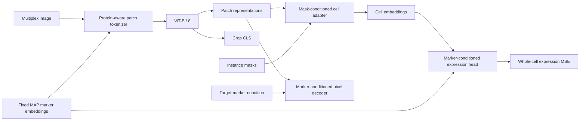

# 模型结构与表示接口

本页维护模型结构与读出接口。首版模块内部参数为 provisional。训练、字段和编辑分别见[训练规范](training.md)、[数据合同](data_contract.md)和[编辑规范](editing.md)。实施与验证进度见[当前状态](../project/status.md)。

## 1. 主路径与初始化

CellWeft 使用单一蛋白图像主干。蛋白图像与固定 MAP marker 表示经 protein-aware tokenizer 构成空间 patch tokens，输入 ViT-B；实例 mask 在主干后与空间特征一起用于细胞读出。Whole-cell 表达是细胞读出的监督目标，不作为主干输入。

1. 基础窗口采用原生 224×224。采样网格、边界与准入见[数据准备](../data/preparation.md#7-crop-与训练视图)。
2. 224×224 crop 的内部 patch 为 8×8，网格为 28×28，共 784 个空间 tokens；每 crop 加一个可学习 CLS。DINO 多视图按视图实际分辨率产生对应数量的 tokens。物理视野按逐图 µm/px 计算。
3. MAP bank 固定为 1,024 维；tokenizer、ViT、cell adapter、表达头与自蒸馏 heads 随机初始化并在预训练中联合优化，像素 decoder 在基座预训练后另行训练。ViT-B 采用 depth 12、width 768、heads 12、MLP 3,072；权重初始化和训练目标按本项目规范确定。
4. Transformer 使用 pre-LayerNorm、residual MSA、GELU MLP 和末端 LayerNorm。Bootstrap 设置为 MLP ratio=4、Q/K/V bias=true、LayerNorm eps=1e-6、attention/MLP dropout=0、drop-path=0；线性层及可学习 token 使用截断正态 std=0.02，bias=0，LayerNorm weight=1。

## 2. 固定蛋白知识表示

Provider 接口保持可插拔；当前方案固定使用 MAP 导出资产。MAP provider 导出 e_m=MAP_gene_projector(ESM2(m))。基础库为 gene symbol 索引的 5,120→1,024 维官方知识编码器输出；每个 study 在输入通道筛选后按 S1 导出固定 marker 向量，操作及保存位置由[数据准备](../data/preparation.md)和[存储规范](storage.md)维护。

ProteinEmbeddingBank 在 study 加载层按 marker_id 匹配当版 marker_embeddings.pt 的 marker_ids 取向量，当版 panel 的 embedding_row 用于核对同版本行号；模型接收已解析的 marker_embeddings。图像 tokenizer 和细胞表达头读取固定 marker 向量及资产版本；像素 decoder 接收目标 marker 条件，但其具体编码和接入 MAP／测量形式信息的方式待落实。Canonical protein 与 measured form 分离，保留 S1 映射及来源提供的 total/phospho、位点、epitope 和 clone 信息；向量维度读取资产 metadata，当前为 1,024。模型接收 measured-form 字段接口；正式词表和编码待模型／训练接线时确定。

保留基础库来源、模型版本、KG snapshot 和已有校验信息。Synthetic 测试使用的随机 bank 显式标注；关系 score 的语义为证据置信度。

## 3. Protein-aware patch tokenizer

对 patch j、marker m，令 v_jm=vec(I_m[A_j])∈R^64，O_jm∈{0,1}^64 为实际可用观测标记：

\[
t^I_{jm}=W_{pix}(O_{jm}\odot v_{jm})+W_{obs}O_{jm}+W^I_{MAP}e_m+e_m^{measurement}\in\mathbb R^{192}.
\]

W_pix 和 W_obs 均为 64→192，W_MAP^I 为 1,024→192。观测标记字段由[数据合同](data_contract.md)维护；measurement-form 使用 192 维 token 接口，正式字段词表及其编码待训练接入时落实。

每个 patch 使用一个可学习 summary s∈R^192。单层 pooling 只计算 summary 的 Query，Key/Value 为包含 summary 自身的 [s,t^I_j1,…,t^I_jM]；输入先 LayerNorm，使用 6 heads、每 head 32 维的标准 attention。Summary attention residual 后，保留 pre-LN FFN（192→768→192）、residual 和 final LayerNorm，最后以 Linear(192,768) 得到 p_j。

这一实现保留单层 marker Transformer 的 summary 输出计算，裁剪不使用的 marker-query rows 及其 FFN 输出。等价性以相同权重、summary 自身 K/V、有效 marker mask、normalization、residual 和 dropout=0 为条件。

该模块按 B×P 批量组织，空间位置之间尚未混合。未测量及 padding marker 不参加 attention；不添加通道序号位置编码。Marker identity 与图像通道成对重排时输出保持一致。局部 marker 遮盖在不同 marker 汇总前作用于图像和观测状态；真实零值与未观测区分。

## 4. ViT-B 与实例条件化细胞读出

对 224×224 crop，ViT-B 将 784 个图像 patch tokens 与一个 CLS 一同编码，输出 H∈R^(784×768) 和 crop CLS∈R^768。按 DINOv2 使用可学习的位置编码，对不同分辨率的视图插值。CLS 直接来自图像主干；instance mask 不进入 tokenizer 或 ViT。训练使用 DINO／iBOT，视图、遮盖及 EMA 由[训练规范](training.md)维护。

在主干后，Mask-Adapter 式读出以每个细胞的实例 mask 为条件，对共享的空间特征生成可学习聚合权重。首版结构为：

| 步骤 | 首版操作 | 输出 |
| --- | --- | --- |
| 共享图像投影 | 将 H 排列为 28×28×768，1×1 Conv 768→128 | 每 crop 一份 28×28×128 特征 |
| 实例 mask 编码 | 三层 3×3、stride=2、padding=1 卷积，1→16→64→128 | 每细胞 28×28×128 特征 |
| 融合与权重 | 两路相加，经 3 个 ConvNeXt blocks 和 1×1 Conv | 每细胞 16 张 28×28 权重图 |
| 空间读出 | 对各权重图在有效 patch 位置 softmax，分别汇总原始 768 维 H，再对 16 个结果求均值 | 每细胞 768 维 contextual embedding |

这是一种针对 CellWeft 的 [Mask-Adapter](https://arxiv.org/abs/2412.04533) 式适配；原方法使用两层 mask 卷积，本模型因 8×8 patch 使用三层。通道宽度、权重图数及卷积设置为 provisional。有效位置排除完全 padding 的 patch；聚合可利用实例外的组织上下文。一个 crop 的图像主干运行一次，同一 crop 的细胞共享 H，实例可并行或分块读取；分块不改变损失和梯度语义。实例 mask 本身保持固定，训练更新主干、adapter 和表达头。

Adapter 在当前视图内使用对应实例的可见 mask，按[数据合同§4](data_contract.md#4-空间对应)确定可读细胞。实例可跨多个 patch。

## 5. Whole-cell 表达预测头

细胞嵌入取自表达预测头之前。对细胞 i 和目标 marker m，以 cell embedding z_i 和固定 MAP 身份及 measurement-form 信息生成查询，采用共享预测头：

\[
q_m=P_M([e_m,\operatorname{form}_m]),\qquad
\widehat{x}_{im}=\operatorname{MLP}([P_C(z_i),q_m]).
\]

首版 P_C 与 P_M 分别输出 256 维，MLP 为 512→256→1，为 provisional 配置。同一头按实际 panel 对各 marker 共享，监督目标与归约见[训练规范§3](training.md#3-联合训练目标)。

## 6. 表示读出与适配接口

| 接口 | 维度及读取方式 |
| --- | --- |
| Spatial patch | 768；ViT-B 在 224 crop 输出 784 个 patch 表征 |
| Image window / crop | 768；冻结图像主干的 CLS 输出 |
| Cell contextual | 768；instance mask 条件化聚合空间特征，取表达预测头之前的向量 |
| Niche / region / ROI / tissue | 按任务 selection、coverage／ownership 和 pooling 读取 cell 或 crop 表征 |

邻域分析可使用现有细胞坐标、近邻索引及 contextual cell embeddings。组织推理的 CLS 只依赖蛋白图像输入；仅改变实例 mask 时，细胞读出可变化，图像 CLS 不变化。EMA 主干与对应 EMA cell adapter 配套导出，规则见[训练规范](training.md)。

窗口特征导出、image／patient crop-bag MIL 及检索接口见[表征评价§4](../evaluation/representation.md#4-figure-3-组织结构理解与表型应用)。

## 7. 图像 marker 重建读出

Figure 2／3 共享目标 marker 条件化的 VirTues 式像素 decoder。训练及权重共享见[训练规范§5](training.md#5-预训练后的像素-decoder)，任务与评分见[表征评价](../evaluation/representation.md)。

首版 decoder 暂按 4 层、width 512、8 heads 的 Transformer 作为 provisional 配置；接口接收空间 patch 特征、位置和目标 marker 条件，所有 marker 共享参数。目标 marker 条件的具体编码及其在 decoder 中的注入方式待实现时确定。对每个目标 marker 的每个空间 patch 输出 8×8=64 个像素，单个 224 crop 最终重组为 [M,224,224]，同时携带有效域。Figure 2 M1–M4 与 Figure 3 S1 使用同一 decoder 权重；目标 marker 的训练可见性和评分规则由各评价协议维护。该结构参考 VirTues 的逐 patch 像素预测；共享空间特征和 marker 条件的接线与测试待完成。
